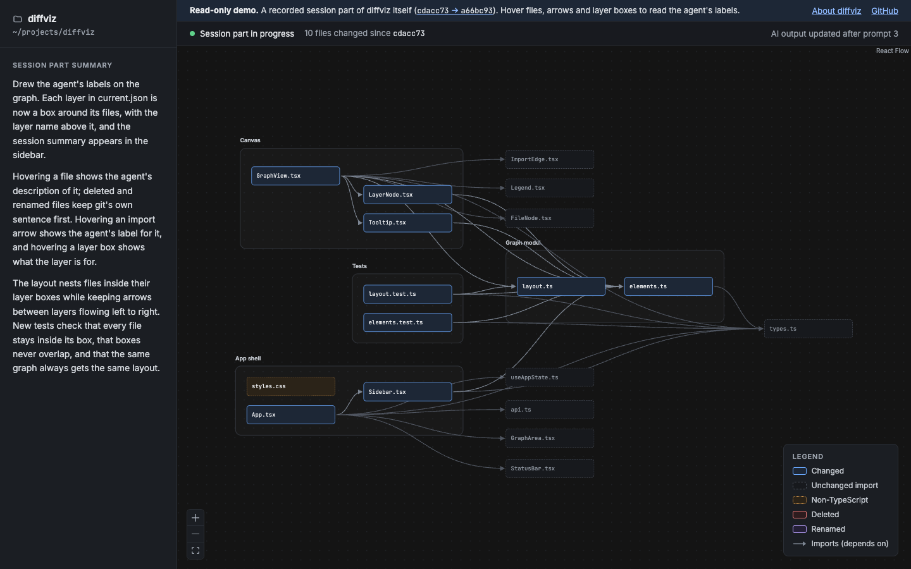

# diffviz

**See what your coding agent changed.** diffviz graphs every file a coding agent changes in your TypeScript
project, live from git, and labels the graph with the agent's own description of the work.

**[Try the live demo](https://diffviz.vercel.app/demo/)**: nothing to install. Hover files, arrows and layer
boxes to read the agent's labels.

[](https://diffviz.vercel.app/demo/)

- **The graph comes from git and the TypeScript compiler**, never from the AI, so it is always accurate.
- **The agent labels it** after every response: a summary, a note per file, layers that group related files,
  and a label for each import.
- **It works alongside Claude Code**, in the same folder, on your machine. No account, no cloud, no database.

## Quick start

In the root of a TypeScript project that uses git:

```sh
npx diffviz
```

diffviz opens in your browser. Then:

1. **Commit the `CLAUDE.md` it added.** It holds the instructions that tell Claude Code to describe its work
   (see [What diffviz adds to your project](#what-diffviz-adds-to-your-project)).
2. **Start Claude Code in the same folder** and work as usual. The graph updates as files change, and the
   labels update after each response.
3. **Commit when a part of the work is done.** diffviz saves that part's final graph and starts again from an
   empty one.

**Requirements:** Node.js 22.22 or newer, and git. The project needs at least one commit.

### Options

| Option | What it does |
| --- | --- |
| `--port <number>` | Port to serve the UI on (default `4300`). If it is taken, the next free port is used. |
| `--no-open` | Don't open the browser. The URL is printed in the terminal. |

The server only listens on `127.0.0.1`, so nothing outside your machine can reach it.

## How it works

### The graph (live, from git)

While the agent works, diffviz watches your files and rebuilds the graph on every save:

1. **git** lists every file that differs from the last commit: added, modified, deleted and renamed, including
   new files that aren't tracked yet.
2. **ts-morph** reads the imports of each changed TypeScript file and resolves them with your `tsconfig.json`,
   including path aliases and workspace packages.
3. **Each changed file is a node, and each import is an arrow** from the file that imports to the file it
   imports (the importer depends on it). Only one hop is shown: imported files that didn't change appear grayed
   out.

| Node | Meaning |
| --- | --- |
| Blue | Changed (added or modified) |
| Gray, dashed | Not changed, but imported by a changed file |
| Amber, dotted | A changed file that isn't TypeScript (CSS, JSON, `.js`, ...). It has no outgoing arrows, but a TypeScript file can point to it. An unchanged one is gray and dotted. |
| Red, struck through | Deleted. Its tooltip says so. |
| Purple, with a "renamed" tag | Renamed. Its tooltip says where it came from. |

Hover a file, an arrow or a layer box to read its description. The deleted and renamed tooltips come from git,
so they are always right.

### The labels (after each response, from the agent)

After every response, Claude Code rewrites `.diffviz/current.json` with a description of **everything changed
since the last commit**: a summary, a description per file, layers, and labels for imports. diffviz then:

1. **validates it** with a Zod schema,
2. **normalizes its paths** (`./src\App.tsx` becomes `src/App.tsx`),
3. **drops anything that doesn't match the real graph**: a note for a file that isn't there, a file in two
   layers (it stays in the first), or a label for an "import" that doesn't exist. What was dropped is printed in
   the terminal.
4. draws the layer boxes, shows the summary in the sidebar, and attaches the descriptions as tooltips,
5. saves a copy of each version.

**The AI can never break or empty the graph.** If its output is missing or invalid, the graph still renders and
the status bar says what went wrong:

| Status | Meaning |
| --- | --- |
| *Uncommitted changes at launch* | The tree was dirty when diffviz started, so that work is mixed into this session part. Commit to start clean. |
| *AI output missing* | The agent finished a response that changed code, but didn't update `current.json`. The labels may be out of date. |
| *AI output invalid* | `current.json` failed validation. The reason is shown, and the last valid labels stay on screen. |

### Session parts

A **session part** is the work between two commits. The graph is cumulative: it always shows everything changed
since the last commit, across every prompt. When you commit, diffviz saves the part's final graph, every version
of `current.json` and your prompts, then starts the next part from an empty graph.

## What diffviz adds to your project

On launch (only inside a git repository), diffviz sets up three things and keeps them up to date. It changes only
what is out of date.

- **`CLAUDE.md`**: a block of instructions, between `<!-- diffviz:start -->` and `<!-- diffviz:end -->`
  markers, appended to your existing file or in a new one. It tells Claude Code to rewrite `current.json` after
  every response and how. Commit it. It shows up as a change until you do.
- **`.claude/settings.local.json`**: two Claude Code hooks. One runs when you send a prompt and one when the
  agent finishes, so diffviz can log both and check whether `current.json` was updated. This is Claude Code's
  settings file for this machine only, and your own settings and hooks in it are kept. The hooks never slow
  down or block the agent: they give up after 2 seconds and always succeed, and do nothing if diffviz isn't
  running.
- **`.git/info/exclude`**: `.diffviz/` and `.claude/settings.local.json` are added to git's per-repository
  ignore list, so they never show up in `git status` or in commits. Your `.gitignore` isn't touched.

### What's stored in `.diffviz/`

```
.diffviz/
  current.json              the agent's latest description (written by the agent)
  server.json               the running server's port, for the hooks
  parts/<base commit>/
    versions/0001.json ...  every valid current.json, in order
    log.jsonl               prompts, responses, and which prompt each version followed
    final.json              the last graph, saved when a commit ends the part
```

All plain JSON files; there is no database.

## The agent's output: `current.json`

The shape the agent writes (`schemaVersion` 1). The instructions in `CLAUDE.md` describe it to the agent.

```ts
type AgentOutput = {
  schemaVersion: 1;
  summary: string;              // what this session part changed so far; paragraphs separated by blank lines
  files: FileNote[];            // shown as node tooltips
  layers: Layer[];              // drawn as boxes around their files
  relationships: Relationship[]; // shown as arrow tooltips
};

type FileNote = { path: string; description: string };
type Layer = { id: string; name: string; description: string; paths: string[] };
type Relationship = { source: string; target: string; label: string; description: string };
```

- Paths are relative to the project root, with forward slashes and the extension.
- Layer `id`s stay the same across rewrites; names and descriptions can change.
- A relationship must match a real import, where `source` imports `target`.

## Limitations

- **TypeScript only.** Imports are read from `.ts`, `.tsx`, `.mts` and `.cts` files. Other files appear as nodes
  without arrows.
- **Claude Code only**, for the labels and the hooks. The graph itself works for changes made by anyone.
- **diffviz has to be running** for prompts and responses to be logged. A commit made while it's closed doesn't
  get a `final.json`, but its versions are kept.
- **The agent's reply is read from Claude Code's session transcript**, whose format isn't a public contract. If
  it changes, turns are still logged, without the reply's text.
- Browsing previous session parts in the UI comes in a later version; for now they are the files above.

## Development

```sh
npm install
npm run dev -- --root ~/path/to/some/project   # the UI with hot reload, watching another project
npm test                                        # unit and fixture tests (Vitest)
npm run typecheck
npm run build                                   # the UI into dist/web, the server into dist/server
```

`npm run dev` without `--root` watches diffviz's own repository, which works too: diffviz can visualize itself.

| Folder | What's in it |
| --- | --- |
| `src/server/` | The CLI and Express server: git (`git.ts`), imports (`imports.ts`), graph (`graph.ts`), the refresh loop (`projectState.ts`), agent output (`agentOutput.ts`, `crossCheck.ts`), setup and hooks (`setup.ts`, `hook.ts`) |
| `src/web/` | The React UI: React Flow for the graph, elkjs for the layout |
| `src/shared/types.ts` | The types the server sends the UI (`GraphState`, `AgentOutput`, ...) |
| `test/`, `fixtures/` | Tests, a small TypeScript project to graph, and recorded `current.json` files. Tests never call a real model. |
| `site/` | The demo website: a homepage and a read-only demo of a recorded session part |
| `docs/SPEC.md` | The full plan for version 1.0.0 |

### The demo site

`site/` is a static site: a homepage, and a demo page that renders a recorded session part of this repository
with the App's own components. No server is involved.

```sh
npm run record-demo   # re-record site/demo/recording/session.json from site/demo/recording/current.json
npm run build:site    # build into dist/site
npx vite preview --config vite.site.config.ts   # look at it locally
```

It is deployed at [diffviz.vercel.app](https://diffviz.vercel.app), which Vercel rebuilds from `main` on every
push using the settings in `vercel.json`.

## License

[MIT](LICENSE)
